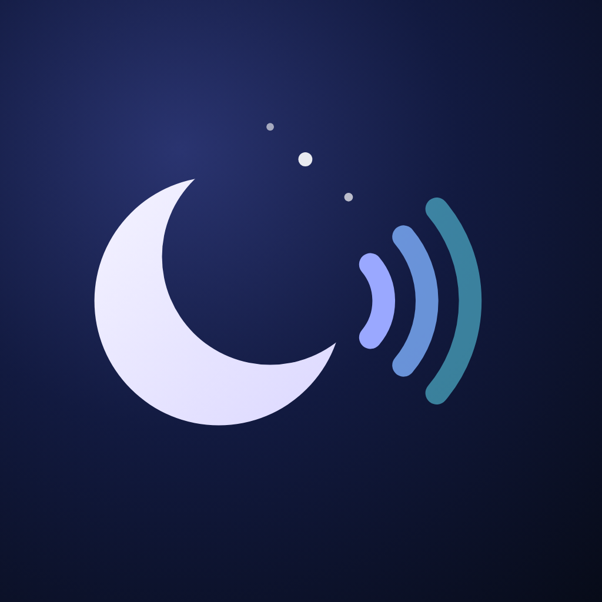
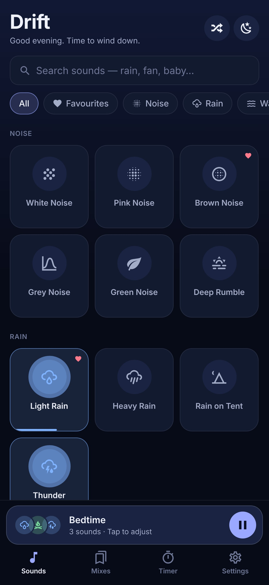
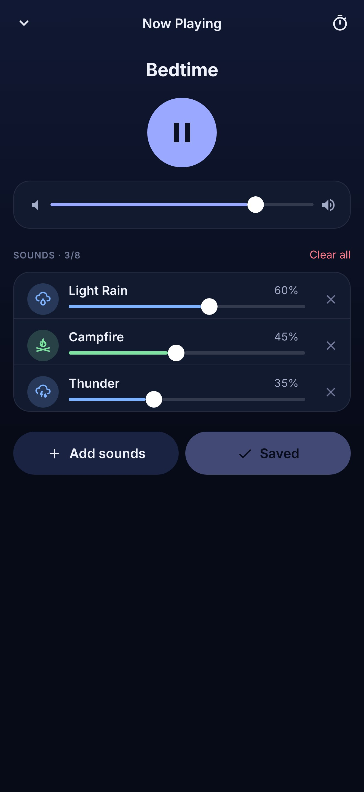
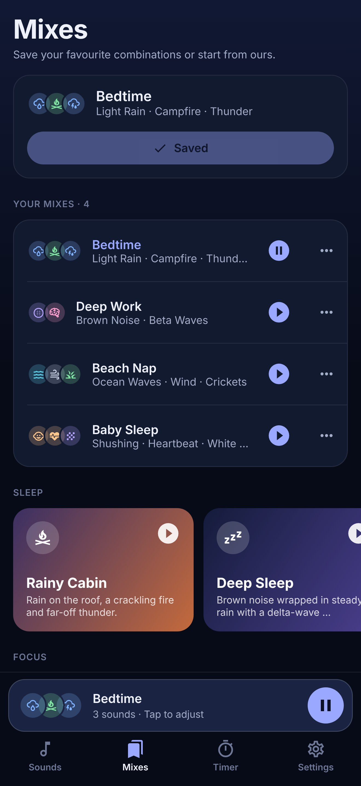
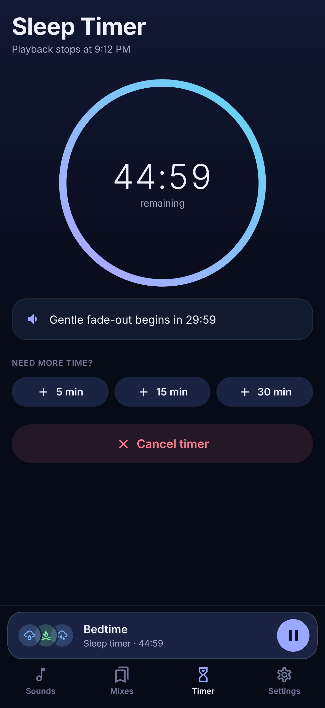
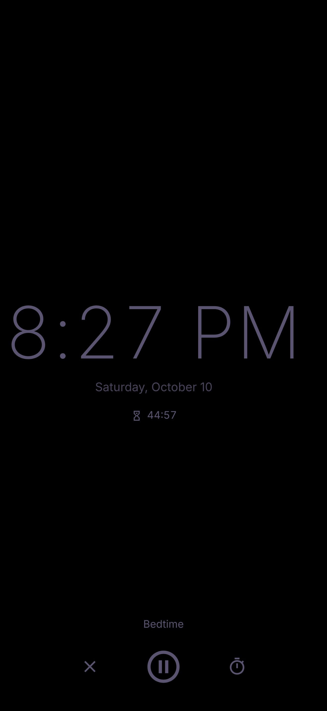

<p align="center">
  
</p>

<h1 align="center">Drift</h1>

<p align="center">
  <strong>Sleep sounds &amp; white noise, mixed your way.</strong><br/>
  Layer rain, ocean, fan, brown noise and 30+ other sounds — then let a gentle sleep timer fade them out.
</p>

<p align="center">
  <a href="https://github.com/NiviJah/Drift/releases/latest"></a>
  
  
  
  
</p>

<p align="center">
  
  
  
  
  
</p>

---

## Download

| Platform | How |
| --- | --- |
| **Android** | Grab the latest `.apk` from **[Releases](https://github.com/NiviJah/Drift/releases/latest)**, open it on your phone and allow installs from your browser or file manager when asked. Test builds are for 64-bit (arm64) phones. |
| **iOS** | Coming to the App Store. Until then, build it yourself with EAS (see [Building](#building--releasing)). |
| **Web** | `npm install && npx expo start --web` |

> Release APKs are signed with a development key for testing. Store builds are produced separately with EAS.

## Features

**🎧 A real mixer**
- Layer up to **8 sounds** at once, each with its own volume, plus a master volume
- **"Surprise me"** builds a random mix that actually works together

**🌧️ 35 seamless sounds in 7 categories**

| Noise | Rain | Water | Nature | Air | Home | Tones |
| --- | --- | --- | --- | --- | --- | --- |
| White · Pink · Brown · Grey · Green · Deep rumble | Light rain · Heavy rain · Rain on tent · Thunder | Ocean waves · Forest stream · Waterfall · Underwater | Campfire · Birdsong · Crickets · Night pond · Cat purr | Wind · Box fan · Air conditioner · Airplane cabin · Hair dryer | Shushing · Heartbeat · Ticking clock · Night train · Clothes dryer | Delta · Theta · Alpha · Beta binaural · Om drone · Singing bowls |

Every loop is gapless, and "living" sounds like thunder and birdsong are triggered at random with varied pitch and position, so they never repeat the same way twice.

**🔎 Find it fast** — search by name or mood (`baby`, `focus`, `storm`), filter by category, favourite what you love.

**💾 Saved mixes** — save, rename, update and delete your own mixes, or start from 12 curated ones in *Sleep*, *Focus*, *Relax* and *Baby* collections.

**⏳ A sleep timer that fades gently** — 5 minutes to 12 hours. Choose how the volume steps down: over the last 1–30 minutes, or gradually across the whole timer. Extend it while it runs.

**🌙 Made for the night**
- Keeps playing with the screen locked; play/pause from the lock screen, notification, headphones or car
- Pauses for calls and resumes after · optional pause when headphones disconnect
- Gentle fade-in on play · optional "play with other apps" (podcasts, music)
- Dim **bedside clock** that keeps the screen on and drifts to prevent burn-in
- Built-in **playback diagnostics** log for troubleshooting Bluetooth or car audio

**🔒 Private by design** — no account, no ads, no analytics, no network calls. Everything stays on your device.

## How it works

Every sound is **synthesized from code** — no recordings, no licensing questions, fully reproducible.

```
synth/recipes/*.ts ──► render 48 kHz loops ──► normalise ──► circular padding ──► MP3 + typed manifest
   (DSP: filters,          (seamless              (balanced        (gapless at          assets/sounds/
    noise, envelopes,       crossfade)             loudness)        any codec delay)     src/audio/generated/
    reverb, events)
```

At runtime the engine (`src/audio/engine.ts`) uses [`react-native-audio-api`](https://docs.swmansion.com/react-native-audio-api/) — the Web Audio API on iOS and Android, and the browser's own Web Audio on web:

```
sound gains ─► master volume ─► play/pause fade ─► sleep-timer fade ─► soft limiter ─► speakers
```

Loops play with sample-accurate loop points, and every fade is scheduled on the audio thread, so it stays smooth with the screen off.

## Tech stack

[Expo SDK 57](https://expo.dev) · React Native 0.86 · TypeScript · Expo Router · [react-native-audio-api](https://github.com/software-mansion/react-native-audio-api) · Zustand + AsyncStorage · react-native-svg · Jest

```
src/app/          screens — tabs (Sounds, Mixes, Timer, Settings) and modals (mixer, save mix, sound details, bedside clock, diagnostics)
src/audio/        sound catalog, audio engine, fade math, OS integration, diagnostics
src/state/        persisted store and curated mixes
src/components/   UI kit, sound tiles, mini player, tab bar, progress ring
synth/            build-time sound synthesis (Node + ffmpeg)
store/            store listing copy, privacy policy, screenshots
scripts/          icon renderer and store-screenshot capture
__tests__/        DSP, fade math, catalog, store and diagnostics tests
```

## Development

```bash
npm install
npm run typecheck && npm run lint && npm test
npx expo start --web            # quickest way to try the UI and audio
```

The audio engine has native code, so on phones use a **development build** rather than Expo Go:

```bash
npx eas-cli@latest build --profile development --platform android   # or ios
npx expo start --dev-client
```

### Regenerating assets

```bash
npm run synth                       # all sounds (needs ffmpeg); add `-- --only rain,fan` for a subset, `-- --wav <dir>` to keep WAVs
node scripts/render-brand.mjs       # icon, adaptive icons, splash, favicon, feature graphic (needs Playwright)
node scripts/store-screenshots.mjs  # store screenshots from the web build
```

## Building & releasing

Cloud builds with [EAS](https://docs.expo.dev/eas/) — no Mac required.

1. `npx eas-cli@latest login` and `npx eas-cli@latest init`
2. Confirm the name and IDs (`com.nivijah.drift`) in `app.json` are available in both stores
3. Host [`store/privacy-policy.html`](store/privacy-policy.html) publicly (GitHub Pages works)
4. `npx eas-cli@latest build --profile production --platform all`
5. `npx eas-cli@latest submit --platform ios` / `--platform android` (Play: save the service-account key as `secrets/google-play-service-account.json`; the first upload must be manual)
6. Copy listing text, keywords, privacy answers and review notes from [`store/listing.md`](store/listing.md); screenshots are in [`store/screenshots/`](store/screenshots)

**Test APKs on GitHub Releases** are built automatically by [`.github/workflows/release.yml`](.github/workflows/release.yml): bump `version` in `app.json`, add `release-notes/v<version>.md`, and push to `main`.

A quick test APK without EAS: `npx expo prebuild --platform android && cd android && ./gradlew assembleRelease`.

## Privacy

Drift collects nothing. Saved mixes and settings live only on your device and can be erased from *Settings → Reset all data*. Full policy: [`store/privacy-policy.html`](store/privacy-policy.html).
